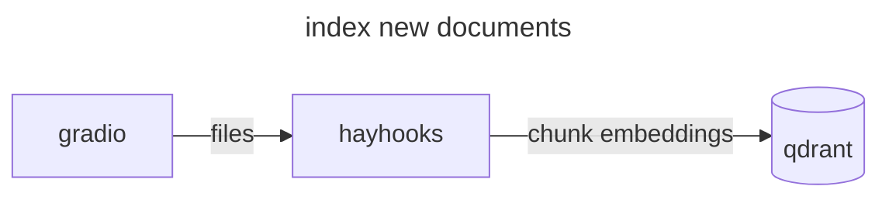
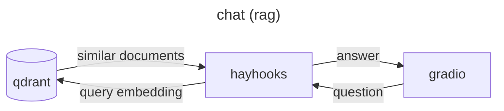

In the second part of our series, we’ll explore how to elevate your machine learning project documentation using powerful plugins. These…

---

In the second part of our series, we’ll explore how to elevate your machine learning project documentation using powerful plugins. These tools can significantly enhance the functionality and readability of your documentation, making it even more valuable and accessible. By leveraging plugins, you can automate docstring parsing, include dynamic content, and integrate rich visualizations, ensuring your documentation is comprehensive, up-to-date, and engaging.

[How to share ML experiments and codeNarrative-driven documentation in machine learning helps reach more people by making experiment results and code easily…medium.com](https://medium.com/@rustemgal/how-to-share-ml-experiments-and-code-38b29bedc5bf)

Having established the importance of creating narrative-driven documentation to make machine learning experiments and code easily understandable and reusable (read part 1 above), the next step is to enhance and customize this documentation for even greater impact. This is where MkDocs plugins come into play.

Plugins can transform basic documentation into a dynamic, interactive resource by automating the inclusion of docstrings, enabling markdown extensions, and incorporating visual elements like diagrams and charts. By leveraging these tools, you can ensure your documentation is not only informative but also engaging and user-friendly, facilitating better understanding and collaboration within the ML community.

---

#### Catalog of plugins

To explore the wide variety of plugins available and find those that best suit your project’s needs, check out the comprehensive [MkDocs Plugins Catalog](https://github.com/mkdocs/catalog). This catalog provides detailed descriptions and usage examples for each plugin, helping you enhance your documentation effortlessly.

#### Customizing the Look

MkDocs offers a variety of themes to customize the appearance of your documentation site. Some popular themes include:

* **ReadTheDocs**: A theme that mimics the Read the Docs style.
* **Material**: A modern, responsive theme based on Google’s Material Design.
* **Cinder:** Cinder offers a sleek, modern look with a dark color scheme that’s easy on the eyes, making it perfect for users who prefer a contemporary aesthetic.


readthedocs vs material vs cinder designs of mkdocs

You can specify the theme in your **mkdocs.yml** file:

```
theme:  
  name: 'material'
```

#### Basic usage

Plugins are a powerful feature of MkDocs, enabling you to extend the functionality of your documentation site. Here are some useful plugins:

* **mkdocs-mermaid2-plugin**: Adds support for Mermaid diagrams to create flowcharts, sequence diagrams, and more.
* **mkdocs-macros-plugin**: Allows the use of macros in your Markdown files.
* **mkdocstrings**: Parses docstrings from your code to generate reference documentation.

To use plugins, install a respective python package with `pip` and add them to your `mkdocs.yml` file:

```
plugins:  
  - search  
  - mermaid2  
  - mkdocstrings
```

#### Docstring parsing

One of the key benefits of MkDocs is its ability to integrate with tools like *mkdocstrings* to automatically generate documentation from your code’s docstrings. This ensures that your documentation is always up-to-date with your codebase. Here’s how you can configure `mkdocstrings`:

```
plugins:  
  - mkdocstrings:  
      handlers:  
        python:  
          options:  
            docstring_style: google  
            show_source: true
```

Install the necessary plugin:

```
pip install mkdocstrings[python]
```

Ensure your Python code includes well-documented docstrings. For example, `my_module.py:`

```
def add(a, b):  
    """  
    Add two numbers.  
  
    Args:  
        a (int): The first number.  
        b (int): The second number.  
      
    Returns:  
        int: The sum of the two numbers.  
    """  
    return a + b  
  
  
def subtract(a, b):  
    """  
    Subtract the second number from the first.  
  
    Args:  
        a (int): The first number.  
        b (int): The second number.  
  
    Returns:  
        int: The difference of the two numbers.  
    """  
    return a - b
```

In your `docs/` directory, create a file named `api.md` and reference the functions using the `:::` syntax supported by `mkdocstrings`:

```
# API Documentation  
  
## Add Function  
::: my_module.add  
    options:  
      show_source: true  
  
## Subtract Function  
::: my_module.subtract  
    options:  
      show_source: true
```

Once you build documentation, you will notice that `mkdocs` parses these docstrings and displays its parameters as a table:


docstring parsing result with the cinder design

#### Add Existing Markdown Files

Your project repository may already contain various Markdown files such as:

* **README.md**: The main introduction to your project.
* **CHANGELOG.md or TRAINLOG.md**: A log of all changes made to your project, which can also serve as a training log for your ML experiments.
* **CONTRIBUTING.md**: Guidelines for contributing to your project.

Luckily, in order to display their contents in our documentation we can utilize a plugin to read markdown without duplicating files inside the `docs/` folder. First, install the plugin via pip:

```
pip install mkdocs-include-markdown-plugin
```

Then, you can include all the contents in the main readme files by adding these lines to `docs/index.md` (note that all readme changes will be reflected in the docs as well):

```

```

#### Mermaid for diagrams

The `mkdocs-mermaid2-plugin` allows you to integrate [Mermaid](https://mermaid.js.org/#/) diagrams into your MkDocs documentation. Mermaid is a powerful tool for creating flowcharts, sequence diagrams, class diagrams, and more using a simple, markdown-like syntax. This can significantly enhance the readability and comprehensiveness of your documentation, making complex information easier to understand.

1. To use the `mkdocs-mermaid2-plugin`, you need to install it and then configure it in your `mkdocs.yml` file.

```
pip install mkdocs-mermaid2-plugin
```

2. Add the plugin to your `mkdocs.yml` configuration file:

```
site_name: My ML Project  
theme:  
  name: 'material'  
nav:  
  - Home: index.md  
  - API: api.md  
plugins:  
  - search  
  - mkdocstrings  
  - mermaid2
```

3. Define mermaid diagrams inside a markdown file using triple backquotes as code samples:

```

  

```

In the code above we create two charts that explain how a [RAG system](https://medium.com/@rustemgal/llm-evaluation-for-rag-applications-9a281dd75b00) works. Mkdocs will be display the diagrams as following:


mermaid diagrams inside mkdocs

#### Dynamic macros

The `mkdocs-macros-plugin` allows you to extend your Markdown files with Python code, enabling dynamic content generation and powerful customizations. [The plugin](https://mkdocs-macros-plugin.readthedocs.io/en/latest/) can execute arbitrary Python code within your documentation, making it possible to include computed values, dynamic tables, and other advanced features.

To use the `mkdocs-macros-plugin`, you need to install it and then configure it in your `mkdocs.yml` file.

```
pip install mkdocs-macros-plugin
```

```
site_name: My ML Project  
theme:  
  name: 'material'  
nav:  
  - Home: index.md  
  - API: api.md  
plugins:  
  - search  
  - mkdocstrings  
  - mermaid2  
  - macros:  
      module_name: docs/main
```

You need to define your Python functions in a separate `.py` file. For example, create a file named `docs/main.py`:

```
def define_env(env):  
    # This function will be called to define macros  
    @env.macro  
    def my_function():  
        return "Hello from Python!"
```

With this setup, when you build and serve your MkDocs site, the placeholder `{{ my_function() }`} in your Markdown file will be replaced with the output of the `my_function` function, displaying *“Hello from Python!”* in your documentation.

---

#### Auto-builds with GitHub/Gitlab

Automating your documentation build process with GitHub Actions or GitLab CI/CD ensures that your documentation is always in sync with your project updates. This not only saves time but also guarantees that your team and users have access to the most current information, enhancing collaboration and project continuity.

**GitHub.** In your repository, create a directory called `.github/workflows` and add a file named `mkdocs.yml` with the following contents:

```
name: Deploy MkDocs  
  
on:  
  push:  
    branches:  
      - main  # or the branch you want to deploy from  
  
jobs:  
  deploy:  
    runs-on: ubuntu-latest  
  
    steps:  
      - name: Checkout repository  
        uses: actions/checkout@v2  
  
      - name: Set up Python  
        uses: actions/setup-python@v2  
        with:  
          python-version: '3.x'  
  
      - name: Install dependencies  
        run: |  
          python -m pip install --upgrade pip  
          pip install mkdocs mkdocs-material mkdocs-mermaid2-plugin mkdocs-macros-plugin  
  
      - name: Build MkDocs site  
        run: mkdocs build  
  
      - name: Deploy to GitHub Pages  
        uses: peaceiris/actions-gh-pages@v3  
        with:  
          github_token: ${{ secrets.GITHUB_TOKEN }}  
          publish_dir: ./site
```

Once you push this configuration to your repository, GitHub Actions will automatically build and deploy your MkDocs site to GitHub Pages whenever you push changes to the specified branch.

**Gitlab.** Create a new `.gitlab-ci.yml` file or add to your existing CI/CD pipeline the following configuration:

```
image: python:3.10  
  
stages:  
  - docs  
  
pages:  
  stage: docs  
  script:  
    - pip install mkdocs mkdocs-material mkdocs-mermaid2-plugin mkdocs-macros-plugin  
    - mkdocs build -d public  
  artifacts:  
    paths:  
      - public  
  rules:  
    - if: $CI_COMMIT_REF_NAME == $CI_DEFAULT_BRANCH  
      changes:  
        - docs/**/*.*  
        - "**/*.md"
```

After pushing this configuration, GitLab CI/CD will automatically build your MkDocs site and deploy it to GitLab Pages whenever changes are pushed to the specified branch.

---

#### Final thoughts

Automating and enhancing your machine learning documentation using MkDocs and its plugins transforms your project into a well-documented, easily understandable, and highly shareable resource. By leveraging tools like Mermaid for diagrams, Macros for dynamic content, and CI/CD pipelines for automatic builds, you ensure that your documentation is always current and engaging.

*If you found this guide helpful and want to stay updated with more tips and tricks on improving your ML projects, don’t forget to subscribe.*
